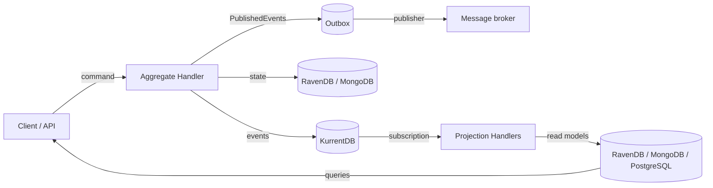

# Rosetta

**Rosetta** is an opinionated F# framework for building Domain-Driven, Event-Sourced services on .NET 11, with CQRS read
models kept up to date by projections. It ships as the `SI.Rosetta.*` NuGet packages.

Commands and events are **F# discriminated unions** whose cases each wrap one record, so the compiler checks that every
command and event is handled, and the record's name is what's stored.

## What you get

| Feature | |
|---|---|
| **Aggregates** | State, behavior and a handler per Aggregate; idempotency, optimistic concurrency (conflicts retried at once) and named business errors built in. [Aggregates](concepts/aggregates.md) |
| **Event Sourcing** | Events stored in KurrentDB, one stream per Aggregate, with opt-in snapshots for long-lived ones; or **state-based** Aggregates in RavenDB, MongoDB or your own PostgreSQL tables; or both in one service. |
| **Outbox** | The integration events an Aggregate publishes, recorded with its state, and published to your broker in order, at least once, from one instance at a time. [Outbox](concepts/outbox.md) |
| **Projections** | KurrentDB subscriptions that keep read models in RavenDB, MongoDB or your own **PostgreSQL** tables, one transaction per event. [Projections](concepts/projections.md) |
| **Custom Projections** | Cross-Aggregate streams, deployed to KurrentDB as JavaScript projections for you: relinked when they change, deleted when they're gone, and their consumers rebuilt. [Custom Projections](concepts/custom-projections.md) |
| **Event evolution** | Stable event names, upcasters, and a clear policy for unknown events. [Event evolution](concepts/event-evolution.md) |
| **Hosting** | One line on `IHostBuilder`, `IHostApplicationBuilder` or `IServiceCollection`, from F# or C#. [Registration](concepts/registration.md) |
| **Observability** | OpenTelemetry traces and metrics, one trace from a request to every read model. [Observability](concepts/observability.md) |
| **TestKits** | Given/When/Then tests for Aggregates, Projections and upcasters, in memory. [Testing](concepts/testing.md) |

## Where to start

- New to Rosetta: [Installation](getting-started/installation.md), then [Your first service](getting-started/first-service.md).
- Structuring a real solution: [Project structure](getting-started/project-structure.md) and [Guidelines](guides/guidelines.md).
- A specific task ("add an event", "rebuild a read model"): [Recipes](guides/recipes.md).
- Something failed: [Troubleshooting](guides/troubleshooting.md).
- An AI agent working in an app that uses Rosetta: [For AI agents](ai.md), or fetch
  [`llms-full.txt`](https://si-informational-systems.github.io/Rosetta/llms-full.txt): the whole documentation in one file.

## Supported infrastructure

| | Version tested | Used for |
|---|---|---|
| .NET | 11 (`net11.0`) | everything |
| KurrentDB | 26.2 (client `KurrentDB.Client` 1.6; 24.10 servers still work) | Event-Sourced Aggregates, Projection subscriptions, Custom Projections |
| RavenDB | 7.2 | state-based Aggregates, Outbox, document read models |
| MongoDB | 8 (a replica set for Projections and the transactional Outbox) | state-based Aggregates, Outbox, document read models |
| PostgreSQL | 18 | state-based Aggregates and read models as rows of your own tables, Outbox |
