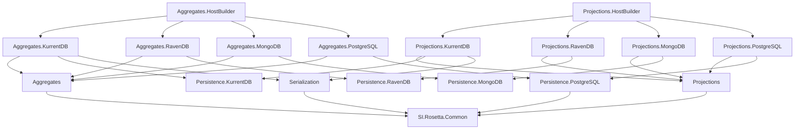

# Packages

All packages target `net11.0` and share one version (1.36 at the time of writing). FSharp.Core comes from the SDK.

| Package | Contains | Depends on |
|---|---|---|
| `SI.Rosetta.Common` | `IAggregateCommands`, `IAggregateEvents`, `ICustomProjectionEvents`; `[<EventType>]`; `IEventUpcaster`, `StoredEvent`, `UnknownEventException`; `EventEncoding`, `OptionFormat`; `RosettaTelemetry`; `PluralizeName`, `TypeKeys` | FSharp.SystemTextJson 1.4, Pluralize.NET |
| `SI.Rosetta.Serialization` | `KurrentDBSerialization`: events as KurrentDB `EventData` and back, through upcasters | Common, KurrentDB.Client 1.6 |
| `SI.Rosetta.Aggregates` | `AggregateState`, `Aggregate`, `AggregateHandler`, repository interfaces, `DomainException`, `ConcurrencyException`, the Outbox types (`OutboxOptions`, `OutboxEvent`, `IOutbox`) | Common |
| `SI.Rosetta.Persistence.KurrentDB` | `KurrentDBFactory`, `KurrentDBServices.AddKurrentDBClients` | KurrentDB.Client |
| `SI.Rosetta.Persistence.RavenDB` | `RavenConfig`, `RavenDocumentStoreFactory` | RavenDB.Client 7.2 |
| `SI.Rosetta.Persistence.MongoDB` | `MongoConfig`, `MongoClientFactory`, `MongoConventions`, the F# BSON serializers | MongoDB.Driver 3 |
| `SI.Rosetta.Persistence.PostgreSQL` | `PostgreSqlConfig`, `PostgreSqlDatabase`; the table mapping shared by read models and Aggregate states (internal) | Common, Npgsql 10 |
| `SI.Rosetta.Aggregates.KurrentDB` | `KurrentDBAggregateRepository` | Aggregates, Persistence.KurrentDB, Serialization |
| `SI.Rosetta.Aggregates.RavenDB` | `RavenDBAggregateRepository`, `RavenDBOutbox`, `RavenDBOutboxEvent` | Aggregates, Persistence.RavenDB |
| `SI.Rosetta.Aggregates.MongoDB` | `MongoDBAggregateRepository`, `MongoDBOutbox`, `MongoDBOutboxEvent` | Aggregates, Persistence.MongoDB |
| `SI.Rosetta.Aggregates.PostgreSQL` | `PostgreSqlAggregateRepository`, `PostgreSqlOutbox` | Aggregates, Persistence.PostgreSQL |
| `SI.Rosetta.Aggregates.HostBuilder` | `UseAggregatesWith…`, `UseOutboxWith`, the store markers | all Aggregates and Persistence packages above |
| `SI.Rosetta.Projections` | `Projection`, the attributes, `IAmHandledBy`, `IProjectInto`, `IProjectionsStore`/`INoSqlStore`/`ISqlStore`, checkpoints, transactions, `ProjectionsFactory` | Common |
| `SI.Rosetta.Projections.KurrentDB` | subscriptions, `ProjectionStatuses`, `ProjectionRetries`, Custom Projection generation and deployment | Projections, Persistence.KurrentDB, Serialization |
| `SI.Rosetta.Projections.RavenDB` | `RavenDbProjectionsStore`, its checkpoint store and unit of work | Projections, Persistence.RavenDB |
| `SI.Rosetta.Projections.MongoDB` | `MongoDbProjectionsStore`, its checkpoint store and unit of work | Projections, Persistence.MongoDB |
| `SI.Rosetta.Projections.PostgreSQL` | `PostgreSqlStore`, its checkpoint store and unit of work, `ReadModelTableException` | Projections, Persistence.PostgreSQL |
| `SI.Rosetta.Projections.HostBuilder` | `UseProjectionsWith…`, the hosted service, `AddRosettaProjections` health check, the store markers | all Projections and Persistence packages above, HealthChecks |
| `SI.Rosetta.Aggregates.TestKit` | `TestKitBase<'THandler>`, `TestKitAggregateRepository` | Aggregates, ObjectComparer, Upcasting, xunit.v3.assert |
| `SI.Rosetta.Projections.TestKit` | `TestKitBase<'TProjection, 'THandler, 'TEvents>`, `TestKitProjectionStore` | Projections, ObjectComparer, Upcasting, xunit.v3.assert |
| `SI.Rosetta.TestKit.Upcasting` | `UpcastingTestKitBase<'TEvents>` | Common, ObjectComparer, xunit.v3.assert |
| `SI.Rosetta.TestKit.ObjectComparer` | `ObjectComparer.DeepCompare` | — |

Every package includes its XML documentation and a symbols package (`.snupkg`).
